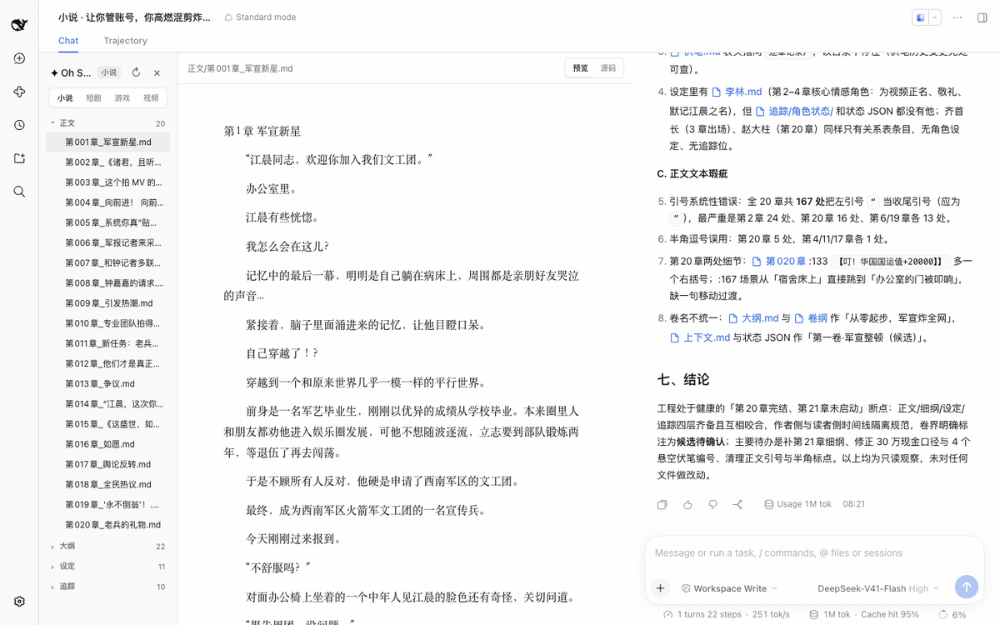
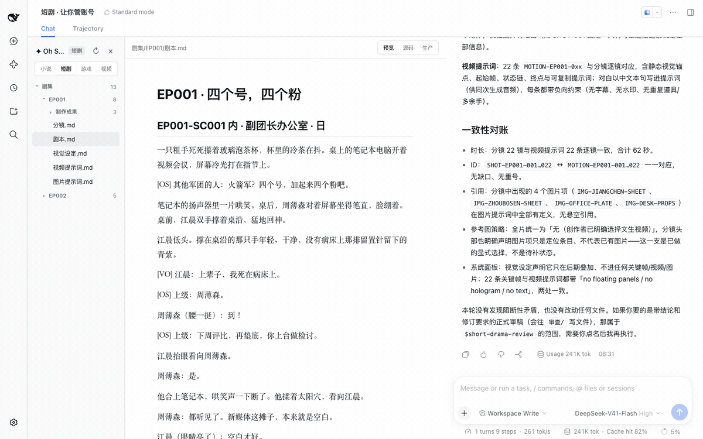
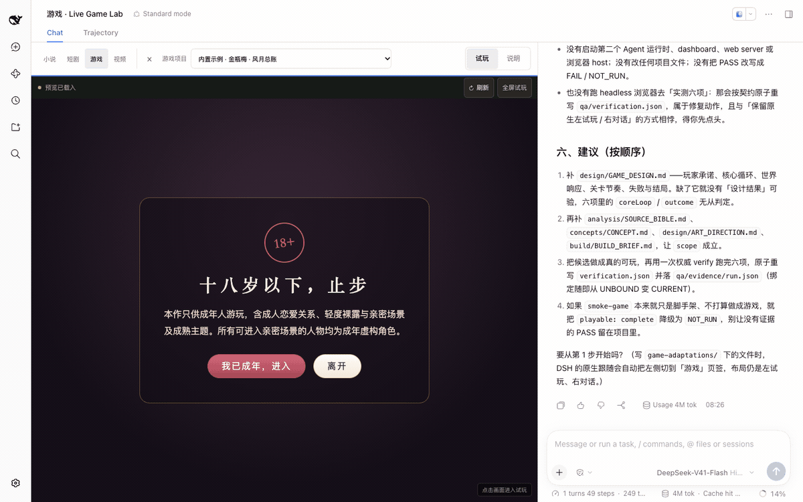
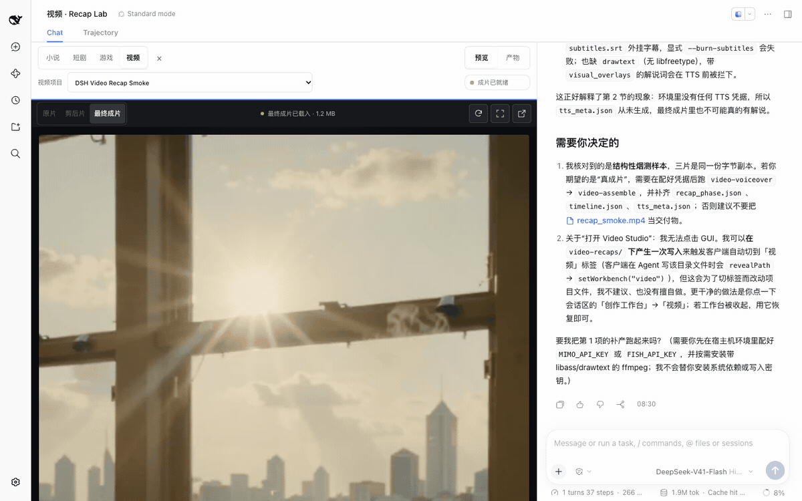

<p align="center">
  
</p>

# dsh-miaowu

<p align="center">
  <b>小说、短剧、互动游戏与视频解说创作工作台，装进 DeepSeek Harness。</b>
</p>

<p align="center">
  <a href="https://zenstory.ai/zh/dsh"><b>上游主页</b></a>
  &nbsp;·&nbsp;
  <a href="#安装"><b>安装</b></a>
  &nbsp;·&nbsp;
  <a href="#看看它的输出"><b>看看它的输出</b></a>
  &nbsp;·&nbsp;
  <a href="README_EN.md"><b>English</b></a>
</p>

<p align="center">
  <a href="https://github.com/zuiyi233/dsh-miaowu/stargazers"></a>
  <a href="https://github.com/zuiyi233/dsh-miaowu/releases/latest"></a>
  
  <a href="./LICENSE"></a>
</p>

`dsh-miaowu` 是基于 DeepSeek Harness（DSH）构建的社区插件，把小说、短剧、互动游戏与视频解说四条创作流水线带进 DSH。DSH 管理 Agent、会话、模型、权限和 Chat；插件提供创作 Skills、专业 Roles、项目协议与对应工作台。

## 这是什么

`dsh-miaowu` 是 [`oh-story-dsh`](https://github.com/zenstory-ai/oh-story-dsh) 的授权 fork，不是上游项目本身。上游由 [ZenStory AI](https://zenstory.ai/zh) 维护；本仓库保留上游的 Skills、Roles 与四个创作工作台，并在此基础上增加 fork 专有能力（见下文「Fork 专有能力」）。包名、仓库地址与发布资产都属于 fork：`@dsh-miaowu/dsh`、`zuiyi233/dsh-miaowu`。

`oh-story-dsh` 是 [DeepSeek Harness](https://github.com/deepseek-ai/deepseek-harness)（DSH）的社区插件，与 DeepSeek 无隶属关系。装上它，DSH Web 里多出四个创作工作台：小说、短剧、游戏、视频解说。Agent、会话、模型、权限审批和 Chat 仍然全是 DSH 原生的，插件只添加创作 Skills、专业 Roles、项目文件协议和工作台界面，不带第二套 Agent 运行时或项目数据库。

以下清单对应当前源码；已发布安装包的上游提交固定在该版本的 manifest 中，未发布更新见 [Unreleased](CHANGELOG.md#unreleased)。

| 工作台 | 上游能力（固定版本，随插件打包） | 主要入口 |
| --- | --- | --- |
| 小说 | [Oh Story 0.9.0](https://github.com/zenstory-ai/oh-story-claudecode/releases/tag/v0.9.0) · 13 Skills · 7 Roles | `/story`、`/story-long-write`、`/story-review` |
| 短剧 | [Drama Skills 0.9.2](https://github.com/zenstory-ai/drama-skills/releases/tag/v0.9.2) · 11 Skills | `/short-drama`、`/short-drama-write`、`/short-drama-storyboard`、`/short-drama-edit` |
| 游戏 | [NovelToGame 0.6.1](https://github.com/zenstory-ai/novel-to-game/releases/tag/v0.6.1) · 7 Skills · 《金瓶梅》ADV 可玩示例（18+） | `/novel-to-game quick`、`/game-build`、`/game-qa` |
| 视频 | [video-recap-skills 0.6.2](https://github.com/zenstory-ai/video-recap-skills/releases/tag/v0.6.2) · 7 Skills（3 个用户入口） | `/video-recap`、`/video-script`、`/video-reference` |

> 当前源码版本 **0.1.19**（2026-10-24）：0.1.19 的预构建包与 npm 包都尚未发布，最近可用的预构建包是 **v0.1.16**，npm 未发布（`@dsh-miaowu/dsh` 在 registry 返回 404）。默认安装固定使用 DeepSeek Harness `0.2.1-rc.3`；仍支持更早的 `0.2.0-rc.2`。变更见 [CHANGELOG.md](CHANGELOG.md) 与 [Releases](https://github.com/zuiyi233/dsh-miaowu/releases)；两条可用安装路径见[安装](#安装)。升级步骤见常见问题[「升级到新版本后要做什么」](#升级到新版本后要做什么)。

## 四个工作台

下面四段动图都是打包后的插件装进官方 DSH Web 的真实画面，取自原生集成测试的录制；右侧 Chat、模型、用量和耗时都是 DSH 自己的。

### 小说



文件树、编辑器、Chat 三栏。Agent 写文件时编辑器跟着它走，点 Chat 里的文件名就能在编辑器打开。覆盖长篇、短篇、选题、扫榜、拆文、导入、审稿、去 AI 味与封面。

### 短剧



每集按需维护最多五份核心创作 Markdown：`剧本.md`、`视觉设定.md`、`分镜.md`、`图片提示词.md`、`视频提示词.md`。「生产」视图把它们投影成镜头板、素材板、任务/版本、成片顺序和可平移缩放的无限关系画布，并就地指出重复 ID、悬空引用与格式错误。生图、生视频、配音、生音乐的任务先预览、你确认后才调用供应商 API；成片由 `/short-drama-edit` 按《剪辑单.md》渲染到 `剧集/<EP>/制作成果/成片/`。

### 游戏



左侧实时试玩、右侧 Chat。`/novel-to-game quick` 的产物写进 `game-adaptations/<project>/`，`build/app/index.html` 就绪后自动进入项目列表，可刷新、全屏、切换项目。游戏在独立 origin 与 iframe sandbox 里运行。随包的《金瓶梅 · 风月总账》ADV 示例不用 API Key 也能玩：还没有作品时点欢迎卡上的「先玩内置示例」，之后在「游戏项目」下拉的「内置示例」里选择。示例改编自古典小说，含成人内容（18+），进入前会确认年龄。

### 视频解说



左侧预览、右侧 Chat。项目放在 `video-recaps/<project>/`：原片在 `sources/`，工作产物在 `work/`，交付在 `outputs/`。可在原片、剪后片、成片之间切换，查看阶段提示、运行清单与质检产物；视频经 HTTP Range 流式预览。还没有视频项目时，空状态先列出运行环境：Python 3.10+、ffmpeg/ffprobe 与 `MIMO_API_KEY` 是否就绪。

### 四个工作台共同的规矩

- **文件就是创作事实**：工作台只投影项目里的文件，不写并行数据库；改哪份文件就是改哪一层决定。人工未保存的内容不会被并发的 Agent 写入覆盖。
- **媒体生产先确认**：短剧媒体任务先在 Chat 展示准确内容与预检结果，你确认同一任务后才执行。媒体 Key 放在宿主机环境变量里，插件只报告是否已配置。
- **不占别的场景**：只有当前 workspace 里真的有创作项目时才接管布局，随时可收起，收起后会话回到 DSH 原生形态，选择按 workspace 记住。

- **实时文件跟随**：Agent 调用官方文件工具时，目标文件自动定位，编辑器同步呈现生成中的内容。
- **Chat 文件导航**：点击官方 Chat 中的作品文件名，文件树会定位并在编辑器打开对应文件。
- **创作文档预览**：Markdown 支持标题、表格、任务列表、引用和代码块；JSONL 以带行号、类型和状态的结构化记录呈现。
- **项目媒体库**：自动汇总当前 workspace 中各集和交付目录的真实图片/视频成果，支持搜索、类型筛选与跨集引用。
- **真实生成契约**：可选内置 GPT Image 2、Seedance 与 MiniMax Music adapter；账号、模型、凭据与可用性由 DSH 运行环境和项目外配置决定。
- **安全编辑**：支持源码编辑与快捷保存；人工未保存内容不会被并发 Agent 修改覆盖。
- **稳定长对话**：消息区独立滚动，官方 Composer 固定在 Chat 栏底部。
- **不占用其他场景**：只有当前 workspace 存在小说、短剧、游戏或视频项目时，工作台才接管会话布局；随时可收起，收起后会话回到 DSH 原生形态，选择按 workspace 记住。

各工作台的边界与协议见[架构说明](docs/ARCHITECTURE.md)。

## Fork 专有能力

以下能力由本仓库（`dsh-miaowu`）在保留上游四个工作台的基础上提供，上游 `oh-story-dsh` 没有。检索、历史、任务、备份、伏笔、书架与保险库的状态默认落在工作区 `.oh-story/` 下的 JSON/JSONL 文件，不引入第二套数据库、Agent 运行时或会话存储；DSH 仍然拥有会话、模型、Provider、权限与运行记录。

- **全文检索**：中文正文与拼音双通道，行级结果带文件、行号与偏移；索引落 `.oh-story/index/`，查询时按文件版本懒刷新，也可全量重建。
- **自诊断**：小说 / 短剧工作台的「自诊断」面板按宿主、运行时、工作区、数据、凭据、集成六组给出 P0/P1/P2；报告只读，支持包需显式确认且默认脱敏；可显式重建索引、重跑备份、检查过期锁，状态格式迁移先备份、可回滚。
- **连续性驾驶舱**：小说 / 短剧工作台把书架、伏笔、run / 候选、审计保存、备份、历史、状态异常与章节追踪聚合成「今天」视图和确定性 P0/P1/P2 风险；只读、不调模型，快照必须显式确认且只写 `.oh-story/backup/`，可复制带 SHA-256 校验和的项目交接清单。
- **有声剧（N4-C，完整成品）**：小说工作台「有声剧」面板把章节确定性切成旁白/对白，支持旁白 + 多个角色、逐段指派说话人与音色映射保存/恢复；生成按每段角色音色走内容寻址缓存，改一段指派或改单个角色音色只重生成受影响段；未指派（或角色已删除）的对白会显示并阻止整章生成/导出。启动或恢复任务可能调用 TTS 产生费用（命中内容寻址缓存的重放不发请求），启动、恢复、素材生成与导出都必须先确认；密钥只从宿主环境读取（生成音频必需 `OH_STORY_TTS_API_KEY`），端点与模型在创建项目时写入，可用可选的 `OH_STORY_TTS_BASE_URL`、`OH_STORY_TTS_MODEL` 作为缺省值，密钥不写入项目、缓存或响应。N4-C 在此之上做完一条成品：`素材/音乐`、`素材/音效` 与 `素材/授权.json` 的素材授权（未授权素材不能挂 cue，导出前再校验一次）、段间固定 120 ms 静音的可编辑 cue 时间轴、两遍 loudnorm 归一到 −16 LUFS 的混音母带、SRT/LRC 字幕、带章节表与 `attached_pic` 封面的 M4B，以及发布包——`有声剧/<书>/发布/` 目录（章节 MP3、M4B、字幕、封面）加 `发布/发布清单.json`（逐文件路径、字节数、sha256 与实测时长，末尾校验和可由 `path` + `sha256` 复算）。真导出前先跑预检（零写入，逐条列出未授权素材、缺封面、缺缓存片段、缺 ffmpeg、章节缺失、空脚本与成本预估）；完整导出需要本机 `ffmpeg`/`ffprobe`，外部素材生成复用 ComfyUI（未配置时返回 503，自备素材仍可登记授权）。数据只写 `有声剧/<书>/` 与 `.oh-story/audiobook/`，不碰 DSH 会话与宿主状态；整书 ≥20 章批量、进程中断后的自动续跑、成本与实际请求数审计、TTS 时长比值复检与波形预览留给 N4-D。
- **质量与性能骨架**：`pnpm eval:quality` 用固定语料与确定性 rubric 对比两版结构产物（不调用模型、不是质量结论）；`pnpm perf:scale` 合成 1M 字 / 10k 文件工作区测量原始文件与 JSON 原语（不是插件级 UI SLO）。详见 [EVALUATION.md](docs/EVALUATION.md) 与 [PERFORMANCE.md](docs/PERFORMANCE.md)。
- **版本历史 / 回滚 / 审计 / 行级批注**：每个文件保留最近 50 个快照，回滚用版本校验拒绝覆盖并发修改；`audit.jsonl` 留痕，批注按原文引用重锚，行号移动记 `moved`、找不到记 `stale` 而不丢批注。
- **候选暂存**：Agent 用 `oh_story_task stage_candidate` 登记建议但不写文件，由你在「任务与候选」面板确认、修订或应用。
- **run / checkpoint / resume**：长任务按 step 记录进度与检查点，中断后从最近暂停或失败的 run 恢复（内置 novel-chapter、drama-batch、game-content 三个 recipe）。
- **备份三件套**：作品包、快照、整体备份；恢复一律写入新目录、不覆盖原项目，离线 JSON 导入走同一套校验。媒体文件只跳过字节，整体备份不含 DSH 会话与 Provider 凭据；启用保险库时 full 备份只收 `vault/secrets.json` 这类文本/JSON 条目，**不含 `vault/master.key`**，没有单独备份的密钥就无法解密，请把主密钥按敏感文件另行保管。
- **伏笔闭环**：埋设、按章提醒、回收状态机与 snooze；可从拆书 sidecar 只读导入。
- **书架**：发现并管理多作品；归档只隐藏记录，30 天回收站与永久移除都不删除工作区文件。
- **可选凭据保险库**：AES-256-GCM，默认关闭；只有设置 `DSH_MIAOWU_VAULT_ENABLED=1` 才启用，不接管 DSH 环境凭据。小说/短剧工作台提供「保险库」面板：默认只列名称，明文仅在显式读取后显示。
- **三个自有 Skills**：`worldbuilding`（先建世界观）、`publishing`（投稿包与发行跟踪）、`finalize`（完结结算与伏笔回收门禁）。
- **ComfyUI 本地接入**：短剧生产适配器与 `oh_story_comfyui` 工具，按 API-format 工作流的占位符调用本机 ComfyUI；未配置工作流时显式报错，不静默切换生图通道。
- **喵呜小说工坊预设**：标准模式全能力加中文小说创作 persona，从源码 checkout 安装到 DSH 的 Agent 预设目录。
- **文件树运行中自动刷新**：角色子代理、后台任务与脚本写入的新文件，在会话运行期间约每 4 秒安静重列；页面隐藏或请求进行中不刷新。
- **按会话 / 工作区布局持久化**：三栏与浮动布局按会话保存，工作台开合按工作区记住；重置布局在布局设置里。
- **上游同步骨架**：`pnpm sync:upstream` 默认 dry-run，对比四套知识资产的 pin 与 DSH 声明范围；`--apply` 要求干净工作树并调用既有资产脚本，不提交、不推送、不打 tag，报告带回滚命令。

各能力的启用方式、可选状态与 UI/工具边界见 [docs/FORK-FEATURES.md](docs/FORK-FEATURES.md)。

## 安装

需要 Node.js 24+。**源码版本是 0.1.19，但 0.1.19 的预构建包与 npm 包都还没发布**：本仓库 GitHub Release 目前只有 `v0.1.16`，npm registry 上 `@dsh-miaowu/dsh` 返回 404（2026-10-24 核对）。现在有两条可用路径。

**推荐：从源码构建当前 0.1.19**（需要本机 pnpm，没有就先 `npm i -g pnpm`）

```bash
git clone https://github.com/zuiyi233/dsh-miaowu.git
cd dsh-miaowu
pnpm install --frozen-lockfile
pnpm --filter @dsh-miaowu/dsh build
pnpm --filter @dsh-miaowu/dsh pack --pack-destination release
npx -y --package @deepseek-ai/dsh@0.2.1-rc.3 dsh plugin --profile web add ./release/dsh-miaowu-dsh-0.1.19.tgz
npx -y @deepseek-ai/dsh@0.2.1-rc.3 web
```

`pack` 在 `release/` 下产出 `dsh-miaowu-dsh-0.1.19.tgz`（`prepack` 会自动再构建一次）。已经在源码 checkout 里时跳过前两行；`dsh plugin add` 若不接受相对路径，换成该文件的绝对路径。

**快速试用：最近发布的预构建包 v0.1.16**（较旧，不含 0.1.17–0.1.19 的更新；这条命令会临时提供 pnpm，只装了 Node.js 的机器也能执行）

```bash
npx -y --package pnpm@11.7.0 --package @deepseek-ai/dsh@0.2.1-rc.3 dsh plugin --profile web add https://github.com/zuiyi233/dsh-miaowu/releases/download/v0.1.16/dsh-miaowu-dsh-0.1.16.tgz &&
npx -y @deepseek-ai/dsh@0.2.1-rc.3 web
```

预构建包与校验和以 [Releases](https://github.com/zuiyi233/dsh-miaowu/releases) 页为准，该页当前的资产就是 v0.1.16。

保持终端运行，浏览器默认自动打开；没有自动打开就复制终端打印的完整 `http://127.0.0.1:3080/?token=...` 链接访问，首次认证需要链接里的 token。关闭终端会停止服务。安装与启动请使用同一个 dsh 版本。本页默认命令固定使用 npm `next` 的 DSH `0.2.1-rc.3`（npm `latest` 目前仍指向 `0.2.1-rc.2`）；本插件接受 `>=0.2.0-rc.2 <0.2.1-0` 与 `>=0.2.1-alpha.1 <0.2.2-0`。仍在用 `0.2.0-rc.2` 时，安装与启动两条命令都要换成 `@deepseek-ai/dsh@0.2.0-rc.2`；不要把两个宿主版本混用。DSH 会在安装与加载时检查版本，不匹配时给出明确提示（`dsh plugin allow-version` 可自担风险放行）。

开始 AI 创作前，在 DSH 的「设置 → 模型」中添加 Provider 并填入 API Key，或在启动前设置环境变量 `DEEPSEEK_API_KEY`。只查看已有作品可在首次引导中选择「稍后配置 / Configure later」。

<details>
<summary>发布后可用：GitHub Release 预构建包与 npm 安装</summary>

**现在没有 0.1.19 的预构建包，也没有 npm 包**（2026-10-24 检查：Release 资产 404，registry 404），不要把版本号套进旧链接，不存在的资产会 404。发布后到 [Releases](https://github.com/zuiyi233/dsh-miaowu/releases) 页复制 tarball 的完整下载地址；下一次发布的标签以 `miaowu-v` 开头，资产路径形如 `.../download/miaowu-v<version>/<asset>.tgz`，`<version>` 与 `<asset>` 都以页面显示为准。安装时把上面源码构建命令里的 `./release/dsh-miaowu-dsh-0.1.19.tgz` 换成该地址即可；npm 同理，确认 `@dsh-miaowu/dsh@<version>` 已发布后再替换包名。发布前请使用源码构建路径或 v0.1.16 预构建包。

</details>

<details>
<summary>视频工作台的宿主机依赖</summary>

视频流水线还需要宿主机安装 Python 3.10+ 与 ffmpeg/ffprobe（Debian/Ubuntu `sudo apt install ffmpeg`）。带 libass `subtitles` 滤镜时会烧录字幕；未提供该滤镜的构建交付外部 SRT，也可另装带 libass 的构建。视频解说另用 `MIMO_API_KEY`（Fish Audio TTS 另需 `FISH_API_KEY`）。Key 与 `PATH` 在启动 DSH 的终端里设置，重启 DSH 后生效。

</details>

<details>
<summary>有声剧导出的宿主机依赖</summary>

有声剧的导出链路——章节 MP3、两遍 loudnorm 混音母带（−16 LUFS）、SRT/LRC 字幕、M4B 章节与封面、发布包——需要本机安装 `ffmpeg` 与 `ffprobe`（Debian/Ubuntu `sudo apt install ffmpeg`）；缺失时预检列出未就绪项，导出返回 503 且不写半成品。TTS 的端点与模型在创建项目时填写，密钥只从启动 DSH 的终端环境读取（必需 `OH_STORY_TTS_API_KEY`，可选缺省 `OH_STORY_TTS_BASE_URL` / `OH_STORY_TTS_MODEL`）。外部 BGM/音效生成复用短剧侧的本机或局域网 ComfyUI 配置，未配置工作流时返回 503；自备的素材文件放进 `素材/音乐` 或 `素材/音效` 并在面板登记 `素材/授权.json` 即可参与混音。

</details>

<details>
<summary>配置媒体生成 API（短剧生产需要）</summary>

DeepSeek 负责写剧本、分镜和提示词；生图、生视频、配音、生音乐由短剧「生产」交给 `short-drama-produce` Skill，再调用下面的供应商 API 完成。生产与检查脚本需要宿主机上的 Python 3.9+。Key 在启动 DSH 之前写入宿主机环境变量：

| 能力 | 供应商 | 必需环境变量 | 可选 |
| --- | --- | --- | --- |
| 图片 | GPT Image 2 | `OPENAI_API_KEY` | `OPENAI_BASE_URL` |
| 视频 | Seedance（火山方舟） | `ARK_API_KEY`、`SEEDANCE_MODEL` | `SEEDANCE_BASE_URL`、`SEEDANCE_ALLOWED_RATIOS`、`SEEDANCE_MIN_DURATION`/`SEEDANCE_MAX_DURATION` |
| 视频 | MiniMax H3 | `MINIMAX_API_KEY`、`MINIMAX_VIDEO_MODEL`、`MINIMAX_VIDEO_RESOLUTIONS`、`MINIMAX_VIDEO_MIN_DURATION`/`MINIMAX_VIDEO_MAX_DURATION` | `MINIMAX_VIDEO_BASE_URL`、`MINIMAX_VIDEO_RATIOS` |
| 语音 | MiniMax Speech | `MINIMAX_API_KEY` | `MINIMAX_BASE_URL` |
| 音乐 | MiniMax Music | `MINIMAX_API_KEY` | `MINIMAX_BASE_URL` |

```bash
export OPENAI_API_KEY=...            # 图片
export ARK_API_KEY=... SEEDANCE_MODEL=...   # 视频，模型/Endpoint ID 以账号开通的为准
npx -y @deepseek-ai/dsh@0.2.1-rc.3 web
```

只配置用得到的那几个即可：没有视频 Key 仍然可以写分镜、生成关键帧图片。「生产」视图顶部会显示每个供应商是否已配置、缺哪个变量。插件启动时会把这五个内置 adapter 登记到一份不含凭据的配置文件（默认在系统临时目录下仅当前用户可读写的 `oh-story-dsh-<uid>/` 里，「生成环境」条会显示完整路径），Agent 运行 `production_tool.py run` 时直接引用它；自己写 adapter 或改超时，就把文件路径写进 `OH_STORY_DRAMA_ADAPTER_CONFIG`。每个供应商的参数、分辨率与时长约束见随包的 `short-drama-produce/references/providers/`。小说封面使用当前 Preset 里可见的图片生成工具。

声音参考需要额外显式配置：自动生成的通用 profile 不声明 `reference_audio`，因为环境变量里的具体模型未必支持声音输入；只有确认所选模型支持后，才在项目外的自定义 adapter 配置里为该 profile 声明 `reference_roles`（包含 `reference_audio`），并用 `OH_STORY_DRAMA_ADAPTER_CONFIG` 指向它。未声明时会在付费提交前拒绝，不会静默丢掉声音。

</details>

<details>
<summary>装进独立 profile，按需启动</summary>

插件装进哪个 profile，那个 profile 的每个 Session 就都会加载创作 Skills。想让原版 `web` 保持干净，就把插件装进独立 profile。下面的命令在源码根目录执行，用的是上一节源码构建出的 0.1.19 tarball；想跳过构建，可换成 v0.1.16 的 Release 资产（相对路径换成 `https://github.com/zuiyi233/dsh-miaowu/releases/download/v0.1.16/dsh-miaowu-dsh-0.1.16.tgz`）：

```bash
npx -y --package pnpm@11.7.0 --package @deepseek-ai/dsh@0.2.1-rc.3 dsh plugin --profile story add ./release/dsh-miaowu-dsh-0.1.19.tgz
```

新 profile 默认没有界面。编辑 `~/.dsh/profiles/story/package.json`，把 `dsh.profile.bundles` 改成：

```jsonc
"bundles": [
  "@deepseek-ai/dsh-base",
  "@deepseek-ai/dsh-web-app",
  "@dsh-miaowu/dsh"
]
```

`@deepseek-ai/dsh-web-app` 是 DSH 自带的 Web 界面包，需要在创作插件之前加载。之后两个 profile 用不同端口可以同时运行，模型、凭据、workspace 与历史会话由 DSH 统一保存：

```bash
npx -y @deepseek-ai/dsh@0.2.1-rc.3 web                          # 原版 DSH
npx -y @deepseek-ai/dsh@0.2.1-rc.3 --profile story --port 3081  # 创作工作台
```

</details>

## 开始创作

首次启动时，DSH 会在「文稿」目录下自动建一个 **默认工作区 / Default workspace**（`deepseek-harness/default-workspace`），并直接打开其中的空白会话，Oh Story 的使用引导显示在会话首页。要在自己的作品目录里创作，点击左侧 Workspaces 旁的 **添加工作区 / Add workspace**，选择存放作品的文件夹，再在下方 **选择工作区 / Choose workspace** 中选中该目录；创作文件会写进当前会话所属的工作区。目录里已有创作项目时，会显示「小说 / 短剧 / 游戏 / 视频」四个工作台标签；空目录保留 DSH 原生 Chat，输入 `/story`、`/short-drama`、`/novel-to-game quick` 或 `/video-recap` 开始，Agent 写出第一个创作文件后工作台自动出现。

下面的请求复制改一改就能用，替换方括号内容后发送。

**开一本新书**：

> 我想开一部 [类型/题材] 新书。先从我提供的材料中分开已确定事实与待决问题；只规划一个有边界的开篇，交付核心冲突、视角限制、前三章变化和待决项。不要自动写正文；题材取舍、角色动机和长期方向留给我确认。

**已有稿件，第一轮只讨论续写方案**：

> 我想规划这部自有或已获授权小说的下一场戏。只阅读当前 workspace 中我点名的 [章节文件] 和 [设定文件]；[末尾片段] 尚未写完，不要把它算成完整章节。先列出与下一场戏有关的已知事实、视角人物目前知道的事，以及尚缺或冲突的信息。再给两个续写方向，分别说明人物要什么、阻力是什么、行动造成什么可见变化；不要提前揭示 [秘密]，停在 [场景边界]。本轮只在 Chat 回复，不创建、移动或改写任何文件。

**短剧、游戏、视频解说**，直接说目标：

```text
用 /short-drama 初始化一个都市打脸题材的短剧项目，竖屏 9:16，只写第 1 集，先不生成任何媒体。
用 /novel-to-game quick 把 [小说文件] 改编成可玩游戏，平台、类型和引擎由你推荐，首个构建控制在 15 分钟以内。
给 /path/to/video.mp4 做一个 3 分钟中文解说成片，保留关键原声，字幕烧进画面。
```

## 看看它的输出

节选自随包示例工程（同步自 [oh-story-claudecode 的 demo](https://github.com/zenstory-ai/oh-story-claudecode/tree/abe96630d115afbd528f2329e2d8d604d5d5673c/demo/%E9%95%BF%E7%AF%87) 与 [drama-skills 的公开样例](https://github.com/zenstory-ai/drama-skills/tree/fdb7b7c58017e3eae64eca382c2a85ede368dab0/examples/creator-first/EP001)），省略处以「……」标出。

### 用追踪文件定位续写

写第 21 章之前，[`追踪/上下文.md`](scripts/demo-fixtures/story/让你管账号，你高燃混剪炸全网/追踪/上下文.md) 记录了当前位置与风险；继续前先用它定位，再按写作流程读取本章细纲、相关设定与必要原文：

```markdown
## 当前位置
- 当前章：第20章
- 场景：火箭军文工团，钟嘉嘉送来老兵书法礼后
……
## 活跃伏笔
- F016｜钟嘉嘉并非普通军报实习生，她的军方家庭背景仍未完全公开｜埋第7章｜回收章未定｜高
……
## 连贯性风险
- 第21章尚无细纲，不能直接写正文。
```

最后一行是硬门禁。没有细纲就写正文，写入会被 DSH 的 `tools/pre-execute` 钩子拒绝：

```text
Oh Story 阻止写入第 21 章：未找到对应的 大纲/细纲_第021章*.md。先按 story-long-write 单章流程补建细纲再写正文。
```

### 一个镜头在短剧五份文档里各管一层

`视觉设定.md` 给跨镜不变的造型上锁，锁面能原样贴进提示词；`分镜.md` 只写起点、唯一动作、终点和依据；`视频提示词.md` 把两点之间的动作写成模型能执行的英文：

```markdown
- 连续性锁：LOCK-JIANGCHEN-DRESS《江晨松枝绿常服》（镜头：SHOT-EP001-002、SHOT-EP001-003、SHOT-EP001-007……；图片提示词项：IMG-JIANGCHEN-SHEET）· 锁面：pine-green lapel service jacket
```

```markdown
## SHOT-EP001-002 · 四个号，四个粉
- 来源：EP001-SC001
- 时长：4s
- 起点：周薄森面对笔记本坐得笔直，右手搭在茶杯旁；江晨双手掌心朝下撑在玻璃桌沿，眼神涣散。
- 唯一动作：哄笑声滚过来，周薄森下颌收紧、腰背又挺直一分；江晨眨了一下眼，眼神猛地聚拢。
- 终点：画面停在周薄森绷紧的脸与屏幕冷光；江晨仍撑着桌沿，留在画右边缘。
- 视觉依据：《视觉设定.md》·人物「江晨」……；道具「玻璃泡茶杯」（控制：双层玻璃杯身、沉底茶叶）。
```

```markdown
## MOTION-EP001-002 · 四个号，四个粉
> …… The seated officer's jaw tightens and his back straightens a little more.
> The young man blinks once and his eyes snap into focus. ……
```

原文：[`剧本.md`](scripts/demo-fixtures/drama/让你管账号/剧集/EP001/剧本.md) · [`视觉设定.md`](scripts/demo-fixtures/drama/让你管账号/剧集/EP001/视觉设定.md) · [`分镜.md`](scripts/demo-fixtures/drama/让你管账号/剧集/EP001/分镜.md) · [`图片提示词.md`](scripts/demo-fixtures/drama/让你管账号/剧集/EP001/图片提示词.md) · [`视频提示词.md`](scripts/demo-fixtures/drama/让你管账号/剧集/EP001/视频提示词.md)。

### 写错了会被指出来

把这集样例故意改坏三处（来源指向不存在的场景、视频提示词指向不存在的镜头、图片提示词 ID 重复），「生产」视图报的是原因和行号：

```text
SHOT-EP001-002 的来源 EP001-SC009 在剧本中不存在。            分镜.md:25
MOTION-EP001-003 指向不存在的 SHOT-EP001-030。                 视频提示词.md:33
IMG-JIANGCHEN-SHEET 在当前集内重复，后出现的条目会遮蔽前一条。   图片提示词.md:3
```

### 随包游戏的 QA 记录

《金瓶梅 · 风月总账》的完整结果见 [`qa/verification.json`](packages/knowledge/novel-to-game/examples/jin-ping-mei/qa/verification.json)。下面保留六项状态与体验限制的简化示意，限制文字并非当前记录的逐字引用：

```json
"checks": { "launch": "PASS", "render": "PASS", "input": "PASS", "coreLoop": "PASS", "outcome": "PASS", "restart": "PASS" },
"limitations": [ ……
  { "scope": "体验判断", "reason": "自动化只证明当前候选可启动、渲染、输入、走到结果并重开，不判断主观吸引力、长期平衡或其他浏览器。" }
]
```

## 常见问题

### 用 DeepSeek 写小说，一定要装插件吗？

只讨论一个梗概或修改一段自带文本，用普通模型聊天就够，自己把结果放回稿件即可；要围绕本地作品目录持续创作、在工作台里看文件，再装 DSH 加本插件。想用账户化的网页项目，可选 [ZenStory 托管工作台](https://app.zenstory.ai)，具体区别见[写作环境对比](https://zenstory.ai/zh/compare/writing-workflows)。

### 我在用 Claude Code 或 Codex，也该装这个吗？

不用。四条流水线各自是独立的 skill 仓库，直接装进你在用的编程 Agent：[oh-story-claudecode](https://github.com/zenstory-ai/oh-story-claudecode)、[drama-skills](https://github.com/zenstory-ai/drama-skills)、[novel-to-game](https://github.com/zenstory-ai/novel-to-game)、[video-recap-skills](https://github.com/zenstory-ai/video-recap-skills)。本插件是这四套 Skills 在 DeepSeek Harness 里的打包版，外加只有 DSH Web 才有的四个工作台。

### 查看已有作品需要 API Key 吗？

不需要。首次引导选择「稍后配置」，打开作品目录就能浏览文件；开始 AI 创作时再配置模型。

### Token 消耗如何？

插件自己不调用模型，用量以 DSH 每条答复下方显示的数字为准。本轮读取的 Skill、参考资料、作品内容与 Role 调用都会影响用量；每个 Role 是一次独立的子 Agent 调用。profile 中的各个 Session 都能发现创作 Skills，具体正文在使用时读取。想让普通编程会话不带这份技能目录，可以装进独立 profile。

### DeepSeek 会自己生图、生视频吗？没有视频 Key 能做什么？

不会。DeepSeek 只写剧本、分镜和提示词，媒体由 `short-drama-produce` 调用 GPT Image 2、Seedance、MiniMax H3、MiniMax Speech 或 MiniMax Music 生成，Key 写在启动 DSH 之前的宿主机环境变量里，只配用得到的那几个。没有视频 Key 仍然可以写完五份文档、生成关键帧图片。

### 分镜或游戏设计写好了，成片和可玩构建从哪来？

短剧成片由 `/short-drama-edit` 按《剪辑单.md》渲染，需要先配置媒体生成 API 并生产出逐镜素材；游戏构建由 `/game-build` 生成，`build/app/index.html` 就绪后自动进入游戏工作台的项目列表。

### 装了插件之后，写代码的普通会话也变成三栏了？

只有当前 workspace 真的有创作项目时才接管布局，没有时插件在界面上完全不出现；工作台标题栏的「收起创作工作台」随时可以收起，选择按 workspace 记住。

### 右侧 Chat 里的长答复被下面的输入框遮住了？

先按安装步骤更新插件并重启 DSH。当前版本仍能复现时，请带插件版本、DSH 版本、窗口宽度和操作步骤在本仓库开 Issue。上游历史记录见 [#3](https://github.com/zenstory-ai/oh-story-dsh/issues/3) 与 [#26](https://github.com/zenstory-ai/oh-story-dsh/issues/26)。

### 装好后工作台一片空白，面板和「创作工作台」按钮都不出现？

先核对插件与 DSH 版本，再按[安装](#安装)使用同一条受支持的宿主线：默认 `0.2.1-rc.3`，或更早的 `0.2.0-rc.2`。安装和启动两条命令都要一致。检查同一 profile 中是否已加载插件；仍然空白时，附版本号和终端错误在本仓库开 Issue。上游历史记录：[#50](https://github.com/zenstory-ai/oh-story-dsh/issues/50)。

### 我另外给 Codex 或 OpenCode 装过 Oh Story，DSH 里用的是哪一份？

DSH 也会读取 `~/.agents/skills`，同名时优先用那里的副本，而不是本插件随包、为 DSH 适配过的版本；两份版本不同时，行为以 `~/.agents` 里的为准。想让 DSH 只用插件自带的 Skills，启动前把 `DSH_AGENTS_HOME` 指向另一个目录（例如 `DSH_AGENTS_HOME=~/.dsh-agents npx -y @deepseek-ai/dsh@0.2.1-rc.3 web`），或移走 `~/.agents/skills` 里的同名目录。

### 安装报 `pnpm not found on PATH`？

DSH 的 `plugin add` 内部需要 pnpm，单独运行 `npx @deepseek-ai/dsh ... plugin add` 不会自动补上它。重新执行上面带 `--package pnpm@11.7.0` 的完整安装命令，确认安装成功后再启动。

### 浏览器没打开，或者打开后要求认证？

打开终端打印的完整带 `?token=...` 链接，首次认证需要链接里的 token；端口被占用时用 `web --port 3081`，并访问新打印的链接。

### 没有看到「小说 / 短剧 / 游戏 / 视频」四个标签？

先添加作品目录并打开会话。空目录需要先在 Chat 中运行创作命令，Agent 生成第一个创作文件后工作台才会出现；已收起的工作台可用会话区的「创作工作台」按钮恢复。已有作品仍不显示时，检查安装与启动是否使用同一个 profile，重启 DSH 并刷新页面。装进独立 `story` profile 却没有网页界面，是因为新 profile 需要补上 `@deepseek-ai/dsh-web-app`，见安装一节的折叠说明。

### Windows 能用吗？

能。类型、资产、单测与构建这道门在 CI 里每次都在 macOS 和 Windows 上跑；打包后装进官方 DSH Web 的集成测试在 Linux 上跑。视频流水线在任何平台都需要 Python 3.10+ 与 ffmpeg/ffprobe；有 libass 时烧录字幕，没有时交付外部 SRT；长篇拆文、导入与长篇追踪同样需要宿主机上的 Python 3，短剧的检查与生产脚本需要 Python 3.9+，短剧成片需要 ffmpeg/ffprobe，默认的烧录字幕还要求 ffmpeg 带 libass，剪辑单里有「画面文字」时还需要 Node.js（Remotion）；长篇的章节检查需要 Node.js 18+。

### 升级到新版本后要做什么？

按[安装](#安装)一节执行目标版本的命令：源码路径是 `git pull` 后重新 `build` + `pack`，再对新的 tarball 执行 `dsh plugin add`；预构建包目前只发布了 v0.1.16，0.1.17–0.1.19 只能走源码构建，后续版本改为使用 Releases 页上的 `miaowu-v*` 资产并复制页面给出的完整地址，不要手写版本号；npm 发布后才能直接安装 `@dsh-miaowu/dsh@<版本>`。装好后重启 DSH。安装与启动使用同一个宿主版本；当前支持范围见[安装](#安装)。Skills 与 Roles 随插件打包，无需在项目里重新部署。

0.1.19 收口可靠性：历史回滚与候选应用写盘前自动创建创作树快照，交接清单可在驾驶舱导入校验，备份摘要按文件增量缓存；同时补齐保险库只读面板、服务端下发任务可用动作与短剧生产浮窗。不需要迁移，重装后重启即可。

本仓库 0.1.17 / 0.1.18 跟随上游 Oh Story 0.9.0 与 NovelToGame 0.6.0，并包含插件侧 P2/P3 界面修复；逐项变更见 [CHANGELOG.md](CHANGELOG.md)。

0.1.18 收尾 0.1.17 新用户审计里的界面问题（内置示例入口、视频环境检查、游戏预览状态、短剧 Python 3.9+），不用迁移，重装后重启即可。

0.1.17 带来 Oh Story 0.9.0：各 Skill 的参考资料按写书的步骤重新整理，书稿、设定、追踪和作者记忆不用迁移；DSH 里 Skills 与 Roles 随插件更新，不用重跑 `/story-setup`。之前导入的长篇，续写前先让 `/story-long-write` 把那一卷导入时的旧剧情单元改写成单元卡。短篇平台统一叫「知乎盐言」，旧名「盐选」「番茄短篇」照常认。NovelToGame 0.6.0 会在白盒试玩后和生产过半时按预算复盘范围，`director` 模式在视觉目标候选处停下请你挑选。默认宿主改为 DSH `0.2.1-rc.2`。

按项目类型检查仍需处理的内容：

- **小说作者记忆**：Oh Story 0.8.0 之前留在工作区的「本书：」条目，需要逐书执行 `author_memory_commit.py migrate --workspace {工作区} --book-root {书目录}`；单书布局的两个参数均为工作区本身，也可让 Agent「整理作者记忆」。已经迁移的记忆无需重复操作。写手容纳不下的习惯会在汇报里点名，可再整理合并相近条目。
- **小说细纲**：开始正文前补全本章细纲；只有标题、不计 `#` 与空白不足 30 字的细纲会被拦下。
- **短剧项目**：v0.5 结构化项目不能原地迁为 creator-first 项目。新建项目根，只保留当前需要的创作文档。每镜保留真实场景来源和视觉依据，`REF-*` 声明用途；`剪辑单.md` 在第一个 `## CUT-` 之前列明未采用的 `MOTION-*`。画面文字需要 Remotion；从 Drama Skills 0.8 之前升级时，在 `~/.cache/short-drama-edit/remotion` 重新 `npm install`。想关闭默认同场景接镜匹配，在交付规格写 `- 接镜匹配：无`。
- **角色参考音频**：绑定具体角色，并声明和校验 `reference_roles`、人物身份与禁控条件；音频不进入图片选择器。
- **随包游戏**：当前《金瓶梅》ADV 与旧账务版存档不互通，升级后重新开始示例。
- **视频项目**：旧版中途工作目录可能需要从首阶段重建，不能把旧 PASS 当成新结果。dub 会复刻原说话人的声音，必须先确认音频使用权与说话人授权，再加 `--confirm-voice-rights`，旧续跑命令也遵守同一要求。缺少 libass 时交付外部 SRT。

逐版变化与既有验证证据见 [CHANGELOG.md](CHANGELOG.md) 和[验证说明](docs/VALIDATION.md)。

## 延伸阅读

- [DeepSeek 写小说指南](https://zenstory.ai/zh/dsh/deepseek-novel-writing)：选择作品目录、配置宿主模型，再给出题材、视角与本轮停靠点。
- [导入与续写](https://zenstory.ai/zh/oh-story/import-and-continue)：分清已完成章节、未完成片段、必须保留的设定和下一段范围。
- [短剧角色一致性](https://zenstory.ai/zh/drama-skills/character-consistency)：分清身份、造型与逐镜状态。
- [有后果的游戏选择](https://zenstory.ai/zh/novel-to-game/meaningful-choices)：明确行动代价、可见变化和后续承接。
- [原声与旁白分工](https://zenstory.ai/zh/video-recap/original-audio-and-narration)：先列出关键台词、画面依据和需要解说的空隙。
- [写作环境对比](https://zenstory.ai/zh/compare/writing-workflows)：普通聊天、DSH 插件与托管工作台各适合什么。
- [架构说明](docs/ARCHITECTURE.md)：DSH 与插件各自拥有什么，四个工作台的协议边界。
- [Fork 专有能力](docs/FORK-FEATURES.md)：全文检索、版本历史、任务、备份、伏笔、书架、保险库、ComfyUI 与预设的边界。
- [验证说明](docs/VALIDATION.md)：每一层测试覆盖什么，哪些证据不进 Pull Request CI。

## 贡献与交流

- **GitHub Issues**：[Bug、输出质量 Case、功能请求](https://github.com/zuiyi233/dsh-miaowu/issues/new/choose)，请带上插件版本、DSH 版本和复现步骤。
- 改代码前先读 [CONTRIBUTING.md](CONTRIBUTING.md)：`pnpm verify` 是每个 Pull Request 的质量门，`pnpm test:dsh` 会打包并装进隔离的官方 DSH Web 跑一遍。

## 致谢

- [DeepSeek Harness](https://github.com/deepseek-ai/deepseek-harness)：提供原生插件运行时、Agent、会话、权限审批与 Web 工作台基础。
- [LINUX DO](https://linux.do/)：感谢社区的交流、反馈与开源支持。

[更新日志](CHANGELOG.md) · [贡献指南](CONTRIBUTING.md) · [架构说明](docs/ARCHITECTURE.md) · [安全策略](SECURITY.md)

## ZenStory AI 项目

上游 Oh Story DSH 是 [ZenStory AI](https://zenstory.ai/zh) 的一部分——一组开源、面向 agent 的故事创作、改编与生产工具（GitHub 组织：[zenstory-ai](https://github.com/zenstory-ai)）。本仓库 `dsh-miaowu` 是它的授权 fork，由 fork 维护者独立发布。同组织项目与 fork 对照：

| 项目 | 用途 |
| --- | --- |
| [oh-story-claudecode](https://github.com/zenstory-ai/oh-story-claudecode) | 网文写作 skill 包：扫榜、拆文、写作、去AI味、封面图 |
| [drama-skills](https://github.com/zenstory-ai/drama-skills) | AI 短剧 / 漫剧创作 skill 合集：剧本、资产、分镜、图片/视频提示词、独立审查 |
| [novel-to-game](https://github.com/zenstory-ai/novel-to-game) | 面向原著改编、指定运行环境构建与运行证据 QA 的 agent skills |
| [video-recap-skills](https://github.com/zenstory-ai/video-recap-skills) | 将支持的视频文件制作成中文解说，可选导出可编辑的剪映/CapCut 草稿 |
| [oh-story-dsh](https://github.com/zenstory-ai/oh-story-dsh) | 上游项目：DeepSeek Harness 社区插件，提供小说、短剧、游戏和视频解说工作台 |
| [dsh-miaowu](https://github.com/zuiyi233/dsh-miaowu) | 本仓库：`oh-story-dsh` 的授权 fork，保留四个工作台并增加 Fork 专有能力 |
| [zenstory](https://github.com/zenstory-ai/zenstory) | 对话即创作的 AI 小说写作工作台（[app.zenstory.ai](https://app.zenstory.ai)） |
